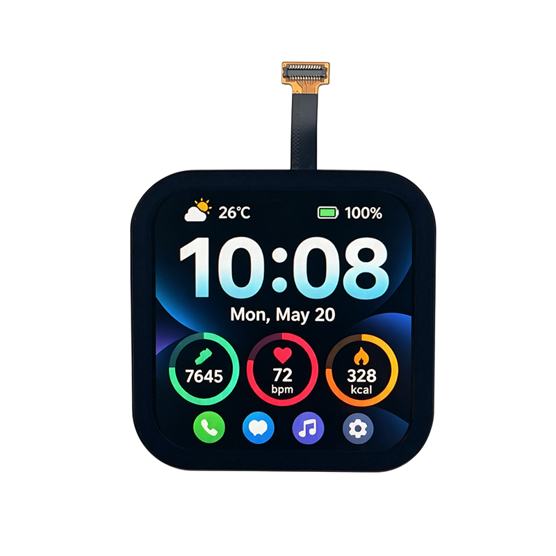

<p align="left"></p>

<h1 align="center">OSPTEK 2.14″ AMOLED 显示屏 480×480（AM214Q480480LK2）</h1>

<p align="center"><b>AMOLED 模组 · QSPI · ST7801N</b></p>

<p align="center"><a href="./README_EN.md">English</a> | 简体中文 · <a href="../../README.md">规格族索引</a></p>

<p align="center">
  
  
  
</p>

<p align="center"></p>

## 目录

- [规格参数](#规格参数)
- [相关资料](#相关资料)
- [仓库结构](#仓库结构)
- [购买链接](#购买链接)
- [技术支持](#技术支持)

---

## 规格参数

| 项目 | 规格 |
| ---- | ---- |
| 尺寸 | 2.14 英寸 |
| 类型 | AMOLED |
| 分辨率 | 480×480 |
| 外形尺寸 | 44.59 x 44.59 x 2.58 mm |
| 有效显示区域 | 38.39 x 38.39 mm |
| 接口 | QSPI |
| 驱动 IC | ST7801N |
| 触摸驱动 | CST9220 |

> 完整外形尺寸、FPC 定义、供电与时序以产品规格书 / 驱动手册为准。

## 相关资料

| 分类 | 文件 |
| ---- | ---- |
| 规格文档 | [`ST7801N_DataSheet_V0.3.pdf`](./datasheets/ST7801N_DataSheet_V0.3.pdf) |
| 规格文档 | [`AM214Q480480LK2.pdf`](./datasheets/AM214Q480480LK2.pdf) |
| CAD 图纸 | [`AM214Q480480LK2.dwg`](./cad/AM214Q480480LK2.dwg) |
| CAD 图纸 | [`AM214Q480480LK2.step`](./cad/AM214Q480480LK2.step) |
| 初始化代码 | [`EDO2.14_480x480_ST7801N_QSPI_简码 .txt`](./code/EDO2.14_480x480_ST7801N_QSPI_%E7%AE%80%E7%A0%81%20.txt) |
| 其他资料 | [`AM214Q480480LK2.step`](./misc/AM214Q480480LK2.step) |

## 仓库结构

```text
display-amoled-2.14inch-480x480/ # 仓库根（导航见 ../../README.md，示例工程见根目录 examples/）
└── versions/
    └── AM214Q480480LK2/        # 本料号完整资料
        ├── README.md
        ├── README_EN.md
        ├── osptek.yml
        ├── images/
        ├── datasheets/       # 产品规格书 + 驱动/触摸 IC 数据手册
        ├── cad/              # 外形/盖板 CAD
        ├── code/             # 初始化参考代码
        └── misc/             # 其他资料
```

## 购买链接

见[仓库首页](../../README.md#购买链接)。

## 技术支持

见[仓库首页](../../README.md#技术支持)。

---

<p align="center"><sub>© 2026 OSPTEK 鱼鹰光电 · 本仓库资料采用 CC BY 4.0 许可</sub></p>
