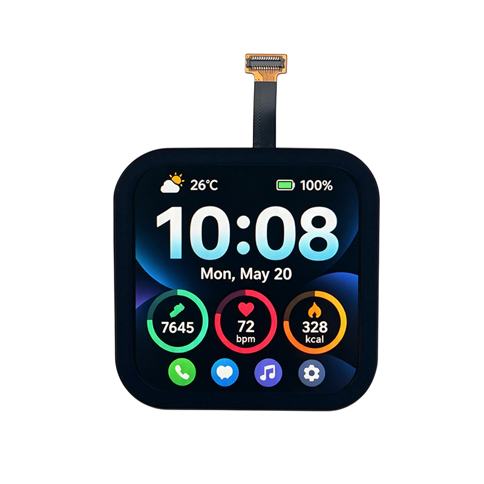

<p align="left"></p>

<h1 align="center">OSPTEK 2.14″ AMOLED Display 480×480 (AM214Q480480LK2)</h1>

<p align="center"><b>AMOLED module · QSPI · ST7801N</b></p>

<p align="center"><a href="./README.md">简体中文</a> | English · <a href="../../README_EN.md">Family index</a></p>

<p align="center">
  
  
  
</p>

<p align="center"></p>

## Contents

- [Specifications](#specifications)
- [Resources](#resources)
- [Repository layout](#repository-layout)
- [Buy](#buy)
- [Support](#support)

---

## Specifications

| Item | Spec |
| ---- | ---- |
| Size | 2.14 inch |
| Type | AMOLED |
| Resolution | 480×480 |
| Outline | 44.59 x 44.59 x 2.58 mm |
| Active area | 38.39 x 38.39 mm |
| Interface | QSPI |
| Driver IC | ST7801N |
| Touch IC | CST9220 |

> Full outline, FPC definition, power, and timing follow the product datasheet / driver IC datasheet.

## Resources

| Category | File |
| ---- | ---- |
| Datasheet | [`ST7801N_DataSheet_V0.3.pdf`](./datasheets/ST7801N_DataSheet_V0.3.pdf) |
| Datasheet | [`AM214Q480480LK2.pdf`](./datasheets/AM214Q480480LK2.pdf) |
| CAD file | [`AM214Q480480LK2.dwg`](./cad/AM214Q480480LK2.dwg) |
| CAD file | [`AM214Q480480LK2.step`](./cad/AM214Q480480LK2.step) |
| Init code | [`EDO2.14_480x480_ST7801N_QSPI_简码 .txt`](./code/EDO2.14_480x480_ST7801N_QSPI_%E7%AE%80%E7%A0%81%20.txt) |
| Other | [`AM214Q480480LK2.step`](./misc/AM214Q480480LK2.step) |

## Repository layout

```text
display-amoled-2.14inch-480x480/ # repo root (nav: ../../README_EN.md; sample projects under root examples/)
└── versions/
    └── AM214Q480480LK2/        # full materials for this part number
        ├── README.md
        ├── README_EN.md
        ├── osptek.yml
        ├── images/
        ├── datasheets/       # product datasheet + driver/touch IC datasheets
        ├── cad/              # outline/cover CAD
        ├── code/             # init reference code
        └── misc/             # other materials
```

## Buy

See the [repo home page](../../README_EN.md#where-to-buy).

## Support

See the [repo home page](../../README_EN.md#support).

---

<p align="center"><sub>© 2026 OSPTEK · Materials in this repository are licensed under CC BY 4.0</sub></p>
